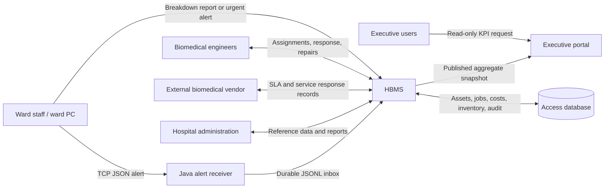
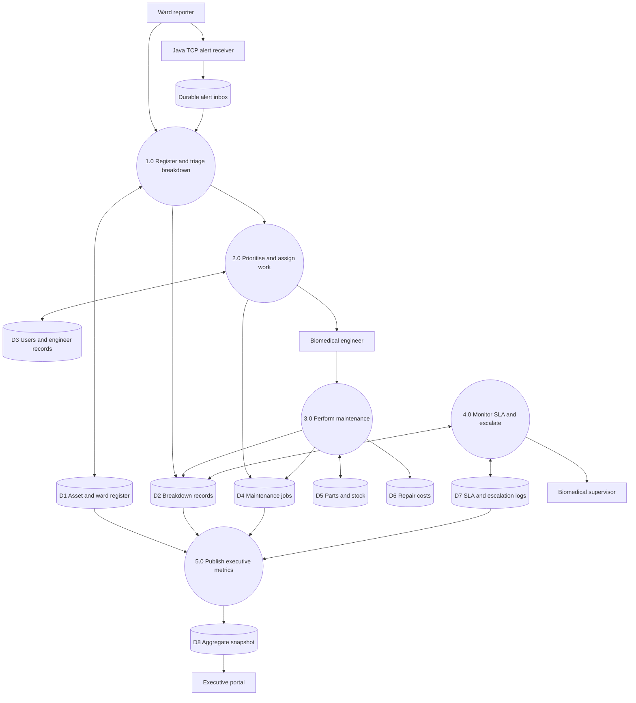
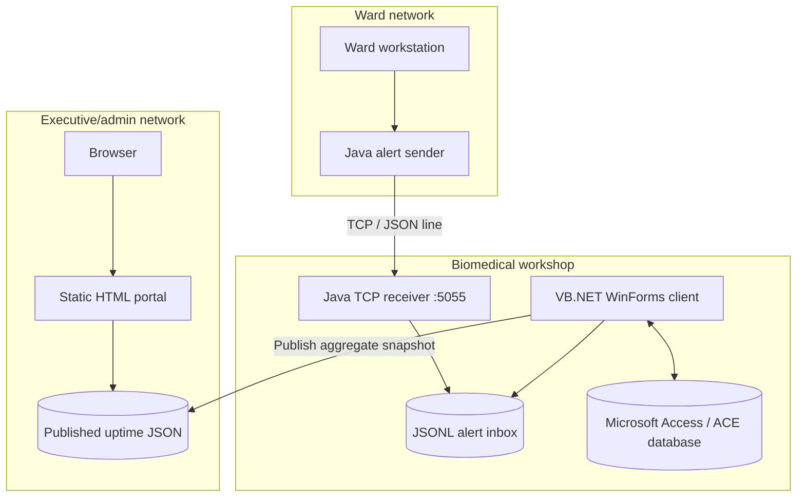
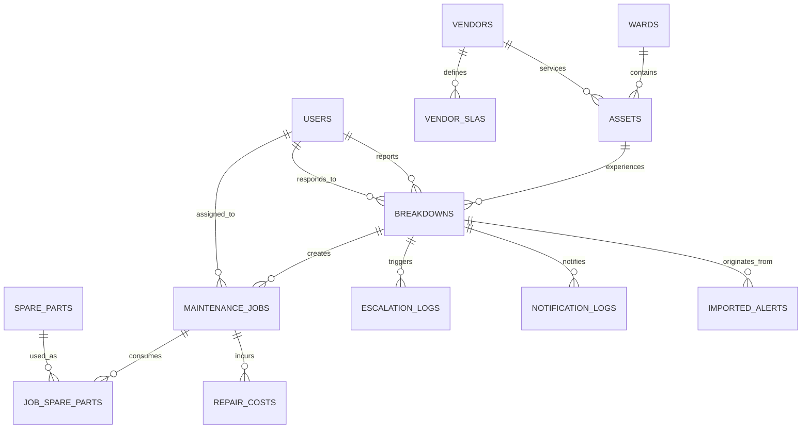

# System Design Package

## Context view

## Level-1 data-flow view

## Deployment view

## Entity relationship view

## Use-case catalogue
| ID | Actor | Use case | Outcome |
|---|---|---|---|
| UC-01 | Ward reporter | Register breakdown | Unique report and response deadline |
| UC-02 | Supervisor | Review priority queue | Critical/highest-priority work visible first |
| UC-03 | Supervisor | Assign engineer | Maintenance job linked to breakdown |
| UC-04 | Engineer | Record response | Response timestamp captured; response SLA stops |
| UC-05 | Engineer | Record diagnosis and repair | Job history updated |
| UC-06 | Engineer/store officer | Record part usage | Stock decremented transactionally |
| UC-07 | Engineer | Record repair costs | Cost ledger updated |
| UC-08 | Engineer/supervisor | Verify and close | Repair verified and breakdown closed |
| UC-09 | Supervisor | Review/escalate overdue response | Unique escalation audit record |
| UC-10 | Ward workstation | Send urgent alert | Durable receiver acknowledgement |
| UC-11 | Supervisor | Import network alerts | Message converted to breakdown once |
| UC-12 | Executive | View department availability | Aggregate KPI snapshot displayed |
| UC-13 | Administrator | Manage reference data/accounts | Controlled system configuration |

## Key business rules
1. Every breakdown belongs to one registered asset.
2. Asset location is derived from the asset's current ward; report history remains attached to the breakdown.
3. Critical-care response target is at most four hours unless an approved effective vendor SLA has a stricter target.
4. Response timestamp and repair completion timestamp are independent.
5. Queue ordering is severity descending, then report timestamp ascending.
6. A stock issue is rejected if requested quantity exceeds available stock.
7. Part usage and stock decrement occur in one transaction.
8. A breakdown cannot be closed without verification notes.
9. Escalation uniqueness is per breakdown and escalation level.
10. A received TCP alert is not considered a database breakdown until imported successfully.
11. Imported alert message IDs are unique.
12. Portal data is an aggregate snapshot; it is not a transactional interface.
