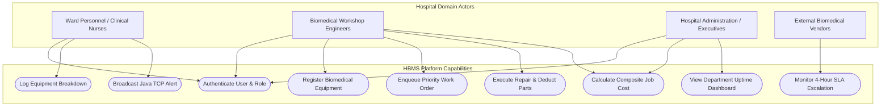
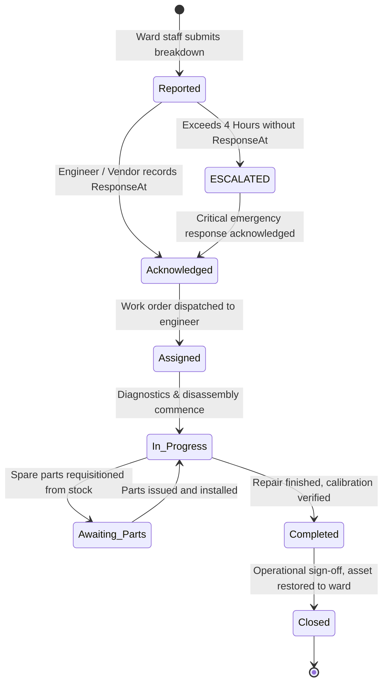
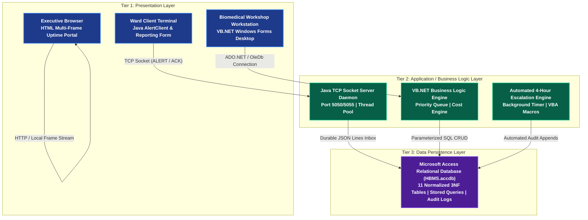
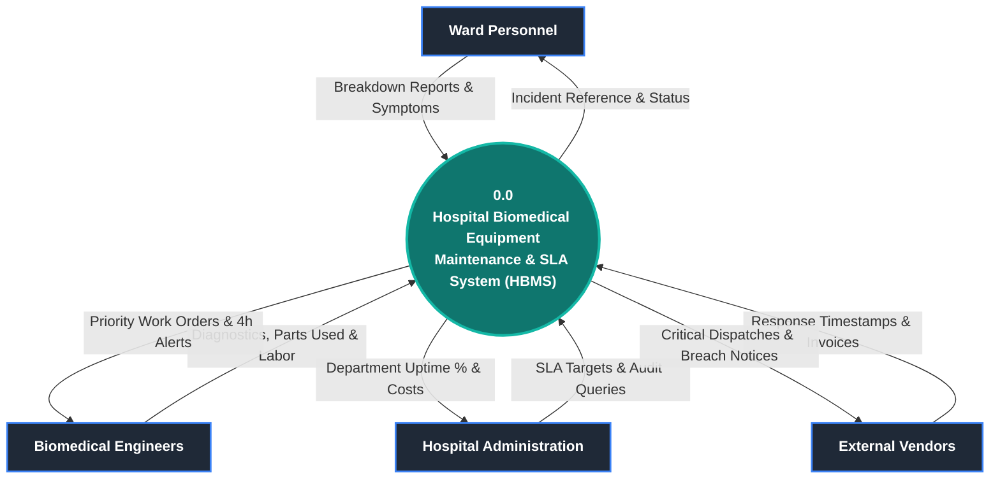
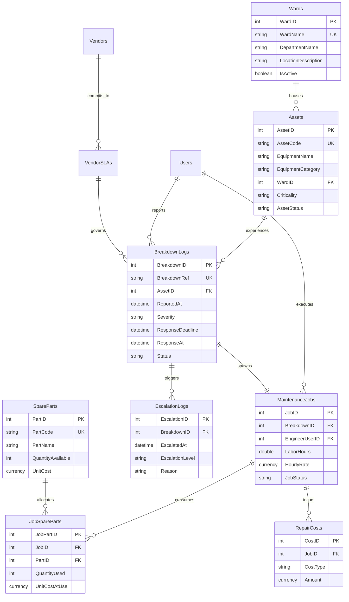

# ECE 2423: Advanced Programming — Group 4
# Project Design, Architecture & Implementation Blueprint
## County Referral Hospital Biomedical Equipment Maintenance & SLA System (HBMS)

**Unit Code & Title:** ECE 2423 – Advanced Programming  
**Programme:** Bachelor of Technology in Electrical and Computer Engineering (Year IV, Semester I)  
**Academic Year:** 2026/2027  
**Institution:** Kirinyaga University — School of Pure and Applied Sciences  
**Department:** Department of Pure and Applied Sciences  
**Lecturer:** Dr. Stephen Kahara Wanjau, PhD  
**Group:** Group 4  
**Assigned Case Study:** County Referral Hospital Biomedical Equipment Maintenance & SLA System  
**Document Status:** Working Design Baseline & Team Reference — Version 1.0  
**CAT Submission Deadline:** Friday, 11 December 2026 (via email to `swanjau@kyu.ac.ke`)  
**Shared GitHub Repository:** [https://github.com/ECE-Group4/CAT2-](https://github.com/ECE-Group4/CAT2-)  

---

## Document Guide & Contents
1. [Executive Summary](#1-executive-summary)
2. [Assignment Requirements and Traceability Matrix](#2-assignment-requirements-and-traceability-matrix)
3. [Project Goals, Scope and Boundaries](#3-project-goals-scope-and-boundaries)
4. [Stakeholders, Actors and Main Use Cases](#4-stakeholders-actors-and-main-use-cases)
5. [System Requirements Specification (SRS)](#5-system-requirements-specification-srs)
6. [Proposed System Workflow & Breakdown Lifecycle](#6-proposed-system-workflow--breakdown-lifecycle)
7. [System Architecture and Data Flow (Context Diagram & DFD Level-1)](#7-system-architecture-and-data-flow)
8. [Database Design — Microsoft Access (1NF to 3NF)](#8-database-design--microsoft-access)
9. [Four-Hour Critical Response Escalation Engine](#9-four-hour-critical-response-escalation-engine)
10. [Visual Basic Desktop Application Design](#10-visual-basic-desktop-application-design)
11. [HTML Executive Dashboard Design](#11-html-executive-dashboard-design)
12. [Java TCP Client-Server Notification Prototype](#12-java-tcp-client-server-notification-prototype)
13. [Component Integration Plan](#13-component-integration-plan)
14. [Testing, Demonstration and Evidence Matrix](#14-testing-demonstration-and-evidence-matrix)
15. [Work Plan, Team Coordination and Review Gates](#15-work-plan-team-coordination-and-review-gates)
16. [Final Report and Submission Package](#16-final-report-and-submission-package)
17. [Confirmed Decisions for the Team](#17-confirmed-decisions-for-the-team)
18. [Course Notes Alignment and Design Principles](#18-course-notes-alignment-and-design-principles)
19. [Team Working Agreement](#19-team-working-agreement)

---

## 1. Executive Summary

This document establishes the comprehensive planning, software engineering design, and implementation reference for **Group 4** in **ECE 2423 – Advanced Programming**. The assigned case study is **“County Referral Hospital Biomedical Equipment Maintenance & SLA System (HBMS)”**.

The project engineers a unified, standalone academic prototype designed to register biomedical equipment assets, record clinical breakdown reports, prioritize engineering work orders, automate 4-hour vendor Service Level Agreement (SLA) response escalation, log repair activities and spare parts, calculate operational equipment downtime/uptime, and broadcast emergency network alerts.

### Governing Objectives:
- **Zero Requirement Loss:** Every requirement in the Group 4 CAT 2 question maps directly to a concrete design, implementation file, verification test, and submission screenshot.
- **Unified Cohesion:** The platform operates as **one integrated system**, not four disjointed demonstrations.
- **Academic Distinction:** The implementation provides an academic prototype simulating realistic hospital engineering workflows without misrepresenting itself as certified clinical software.

---

## 2. Assignment Requirements and Traceability Matrix

| CAT Area | Explicit Requirement | Planned Implementation & Evidence |
|---|---|---|
| **Task 1: Systems Analysis & Modeling** | Structured analysis report | Requirements specification (SRS), system actors, domain scope, operational assumptions, and constraints. |
| **Task 1: Systems Analysis & Modeling** | Context diagram (Level-0 DFD) | System boundary and external information flows across clinical wards, workshop engineers, administration, and vendors. |
| **Task 1: Systems Analysis & Modeling** | Data Flow Diagram (DFD Level-1) | Decomposed functional processes (1.0 to 6.0), persistent data stores (D1 to D5), and labeled data flows. |
| **Task 1: Systems Analysis & Modeling** | 3-tier Client/Server deployment model | Presentation tier (desktop/web/socket client), application tier (logic/escalation/socket server), data tier (MS Access ACCDB). |
| **Task 2: Database & Automation** | Normalized MS Access relational database | 11 relational tables normalized from 1NF to 3NF, primary/foreign keys, referential integrity, and data dictionary. |
| **Task 2: Database & Automation** | Automated 4-hour critical care escalation macros | Queries, background monitoring timer, non-duplicating escalation log records, and audit notifications. |
| **Task 3: Visual Basic GUI** | Visual Basic Windows Forms GUI | Multi-form VB.NET desktop application with responsive controls, data binding, and role-based login. |
| **Task 3: Visual Basic GUI** | Custom modal dialog boxes | Urgent alert dialogs (`DlgCriticalAlert`), action confirmation (`DlgConfirmAction`), and defensive validation popups. |
| **Task 3: Visual Basic GUI** | Logical data structures & priority queues | Custom structured types (`Structure EquipmentRecord`) and severity-based priority queue (Critical Care first). |
| **Task 3: Visual Basic GUI** | Spare parts and repair costs tracking | Interactive forms connected to database calculating: $\text{Total Cost} = \text{Labor} + \text{Parts} + \text{Vendor Fees}$. |
| **Task 4: Web Portal & Networking** | HTML multi-frame web portal | Classic `<frameset>` layout (`header.html`, `navigation.html`, `mainFrame`) with styled typography and tables. |
| **Task 4: Web Portal & Networking** | Hospital ward maps | Interactive client-side image map (`wards.html`) with clickable departmental hotspot regions. |
| **Task 4: Web Portal & Networking** | Department-wise equipment uptime | Uptime calculation and status dashboard displaying operational availability percentages by ward. |
| **Task 4: Web Portal & Networking** | Java client-server TCP alert prototype | Multi-threaded Java TCP socket server (`BiomedicalServer`) on port 5050/5055, ward sender (`WardAlertClient`), and structured ACKs. |

---

## 3. Project Goals, Scope and Boundaries

### 3.1 Project Goals
1. Maintain a centralized register of biomedical equipment and its ward locations.
2. Record breakdown reports with immutable timestamps, clinical severity, and equipment references.
3. Track contracted biomedical vendors and enforce response-time commitments.
4. Automatically flag and escalate critical-care equipment breakdowns that exceed a 4-hour response deadline.
5. Assign engineering work orders, log diagnostics, consume spare parts, and itemize total repair expenditures.
6. Provide executive web views of departmental equipment availability and uptime.
7. Demonstrate an authenticated Java TCP socket notification channel from ward terminals to the central workshop.

### 3.2 Target Biomedical Equipment Categories
The system models and manages four core clinical categories:
1. **Mechanical Ventilators:** Life-support intensive care and anaesthesia ventilators (e.g. Hamilton-C6, Draeger Evita V800). *Criticality: Critical Care (Statutory 4-Hour Response Rule).*
2. **Patient Monitors:** Multi-parameter vitals signs monitors (e.g. Mindray ePM 12M, Philips IntelliVue MX40). *Criticality: Critical Care / High.*
3. **Infusion Pumps:** Volumetric syringe and drip infusion pumps (e.g. Alaris GH Plus, B. Braun Infusomat Space). *Criticality: General Care / Medium.*
4. **X-Ray Units:** Mobile and stationary diagnostic radiographic systems (e.g. GE Optima XR220amx, Shimadzu MobileDaRt). *Criticality: Diagnostic / Routine.*

### 3.3 Scope Boundaries
- **In Scope:** Asset master data, ward locations, vendor SLAs, fault intake, priority queuing, automated 4-hour escalation, maintenance work orders, spare parts stock, cost ledger, HTML frameset portal, client-side ward floor plan image map, and Java TCP socket messaging.
- **Out of Scope:** Direct physical control of medical hardware, real-time patient physiological signals, live SMS gateway payments, and external production web hosting.

---

## 4. Stakeholders, Actors and Main Use Cases



---

## 5. System Requirements Specification (SRS)

### 5.1 Functional Requirements (FR)
- **FR-01 (Asset Inventory):** Register biomedical equipment with unique `AssetCode`, `EquipmentName`, `EquipmentCategory`, `Manufacturer`, `Model`, `SerialNumber`, `WardID`, `Criticality`, `AssetStatus`, and `DateCommissioned`.
- **FR-02 (Ward Master):** Maintain hospital clinical units (`WardID`, `WardCode`, `WardName`, `DepartmentName`, `LocationDescription`, `IsActive`).
- **FR-03 (Vendor Register):** Record contracted medical equipment manufacturers and emergency support vendors.
- **FR-04 (SLA Configuration):** Define response windows (`ResponseHours`) and resolution targets (`ResolutionHours`) per vendor and category.
- **FR-05 (Breakdown Intake):** Log equipment breakdowns, generating unique `BreakdownRef` (e.g. `BRK-2026-001`), capturing `ReportedAt`, `Severity`, and symptom descriptions.
- **FR-06 (Automated Response Deadline):** Automatically compute: $\text{ResponseDeadline} = \text{ReportedAt} + \text{ResponseHours}$ (4.0 hours for Critical Care).
- **FR-07 (Automated 4-Hour Escalation):** Identify unattended critical breakdowns where $\text{ResponseAt IS NULL}$ and $\text{CurrentTime} > \text{ResponseDeadline}$. Create an audit entry in `EscalationLogs` exactly once.
- **FR-08 (Priority Queuing):** Rank work orders dynamically: Priority 1 (Critical Care life-support) $\rightarrow$ Priority 2 (High) $\rightarrow$ Priority 3 (Medium) $\rightarrow$ Priority 4 (Low), with secondary FIFO tie-breaking on `ReportedAt`.
- **FR-09 (Maintenance Execution):** Assign engineer, record diagnostic findings, labor hours, and technical completion.
- **FR-10 (Spare Parts Stock Control):** Maintain parts catalog with quantities and unit costs; deduct stock atomically upon job allocation.
- **FR-11 (Repair Cost Accounting):** Calculate: $\text{Total Cost} = (\text{Labor Hours} \times \text{Hourly Rate}) + \sum (\text{Qty} \times \text{Unit Cost}) + \text{Vendor Fees}$.
- **FR-12 (Equipment Restoration):** Upon job verification, automatically restore `Assets.AssetStatus = 'Operational'`.
- **FR-13 (Departmental Uptime):** Calculate operational availability:
  $$\text{Uptime (\%)} = \left[ \frac{\text{Observation Hours} - \text{Total Downtime}}{\text{Observation Hours}} \right] \times 100$$
- **FR-14 (Java Network Alerts):** Transmit urgent breakdown packets over TCP/IP from ward terminals; server validates and writes to inbox before returning ACK.

---

## 6. Proposed System Workflow & Breakdown Lifecycle



### Complete Workflow Walkthrough:
1. **Incident Intake:** Ward nurse logs failure on ward terminal or transmits Java TCP alert.
2. **Triage & Queue:** System creates `BreakdownLogs` record, calculates 4-hour response deadline for critical devices, and inserts into Priority 1 queue.
3. **Escalation Surveillance:** Background timer verifies response status. If 4 hours elapse without acknowledgment, an immutable audit event is logged into `EscalationLogs`.
4. **Engineer Response:** Engineer acknowledges incident (`ResponseAt = Now()`), stopping the escalation countdown.
5. **Repair & Parts:** Engineer logs diagnostics, issues spare parts from inventory (`JobSpareParts`), and logs labor hours.
6. **Cost Accounting & Closure:** System aggregates labor, parts, and vendor expenses into `RepairCosts`, marks asset `Operational`, and closes the ticket.
7. **Executive Reporting:** Executive portal updates ward uptime percentage and SLA performance metrics.

---

## 7. System Architecture and Data Flow

### 7.1 Three-Tier Client/Server Architecture



### 7.2 System Context Diagram (Level-0 DFD)



### 7.3 Data Flow Diagram Level-1 (DFD Level-1)
- **Process 1.0 (Asset Management):** Manages equipment and ward allocations $\rightarrow$ Store **D1 (Assets & Wards)**.
- **Process 2.0 (Breakdown Reporting):** Intakes fault reports, generates `BRK-Ref` $\rightarrow$ Store **D3 (BreakdownLogs)**.
- **Process 3.0 (Priority Queuing & SLA Tracking):** Computes 4-hour response deadline, ranks work orders $\rightarrow$ Dispatches to Engineers.
- **Process 4.0 (Maintenance Management):** Logs labor, deducts parts from **D4 (SpareParts)**, inserts into `JobSpareParts` and `RepairCosts`.
- **Process 5.0 (Notification & Escalation):** Listens on TCP socket, detects 4-hour breaches $\rightarrow$ Writes to **D5 (EscalationLogs)**.
- **Process 6.0 (Reporting & Analytics):** Computes department-level uptime % and aggregates maintenance expenditures.

---

## 8. Database Design — Microsoft Access

The database is structured in **Third Normal Form (3NF)** with 11 relational tables:



### Normalization Highlights:
- **1NF:** Atomic attributes in all columns; zero repeating groups; primary keys on all tables.
- **2NF:** Elimination of partial dependencies; composite job-part relationships isolated into `JobSpareParts`.
- **3NF:** Elimination of transitive dependencies; vendor profiles, ward locations, and SLAs separated from breakdown logs.

---

## 9. Four-Hour Critical Response Escalation Engine

### Statutory Deadline Rule
$$\text{ResponseDeadline} = \text{ReportedAt} + 4.0\text{ Hours}$$
A breach is flagged when:
$$\text{Severity} \in \{\text{'Critical'}\} \quad \text{AND} \quad \text{ResponseAt IS NULL} \quad \text{AND} \quad \text{CurrentTime} > \text{ResponseDeadline}$$

### Technical Automation Design
1. **SQL Identification Query (`qry_OverdueCriticalCareBreakdowns`):** Selects critical records that have breached the 4-hour window and do not already exist in `EscalationLogs`.
2. **Access Macro / VBA Handler (`mcr_CheckEscalations`):** Appends breach details to `EscalationLogs` and updates breakdown status to `ESCALATED`.
3. **Desktop Poller Timer:** VB.NET background `Timer` (every 30–60 seconds) invokes the check, preventing duplicate escalations.

---

## 10. Visual Basic Desktop Application Design

### Form Modules Architecture
- `FrmLogin`: Role-based authentication (Engineer, Ward User, Administrator).
- `FrmMainDashboard`: Executive KPI summary cards (Total Assets, Active Breakdowns, 4h Breaches).
- `FrmEquipment`: Full CRUD management for biomedical equipment.
- `FrmBreakdown`: Incident intake with autofill and automatic 4-hour deadline calculation.
- `FrmSLA`: Real-time SLA countdown timers color-coded by urgency (Green $>2\text{h}$, Amber $<2\text{h}$, Red Breached).
- `FrmMaintenanceJobs`: Work order tracking from `Assigned` to `Completed`.
- `FrmSpareParts`: Stock level monitoring and reorder warnings.
- `FrmRepairCosts`: Financial ledger aggregating labor, parts, and vendor expenses.
- `DlgCriticalAlert`: High-priority modal dialog for urgent breakdown notifications.

### In-Memory Priority Queue Policy
```vb
Public Structure BreakdownQueueItem
    Public BreakdownID As Integer
    Public BreakdownRef As String
    Public AssetCode As String
    Public PriorityScore As Integer ' 1: Critical Care, 2: High, 3: Medium, 4: Low
    Public ReportedAt As DateTime
    Public ResponseDeadline As DateTime
End Structure
```
Order of execution: Priority 1 (Ventilators/Monitors) $\rightarrow$ Priority 2 $\rightarrow$ Priority 3 $\rightarrow$ Priority 4 $\rightarrow$ FIFO on `ReportedAt`.

---

## 11. HTML Executive Dashboard Design

### Multi-Frame Layout Structure (`index.html`)
- **Top Frame (`header.html`):** Hospital banner, branding, system status badge.
- **Left Frame (`navigation.html`):** Sidebar navigation links targeting `mainFrame`.
- **Main Frame (`mainFrame`):** Displays content pages (`overview.html`, `equipment.html`, `wards.html`, `sla.html`, `uptime.html`).
- **Interactive Ward Map (`wards.html`):** Client-side `<map>` and `<area>` hotspots for ICU, Operating Theatre, Emergency, Radiology, and General Wards.

---

## 12. Java TCP Client-Server Notification Prototype

### Alert Protocol Specification
- **Client Outgoing Alert:**
  ```text
  {"messageId":"<UUID>","assetCode":"EQ-VENT-001","ward":"ICU","severity":"CRITICAL","reportedAt":"<ISO-8601>","description":"<Text>"}
  ```
- **Server Acknowledgment (ACK):**
  ```text
  {"messageId":"<UUID>","status":"RECEIVED"}
  ```
- **Server Error (REJECTED):**
  ```text
  {"status":"REJECTED","reason":"<Reason>"}
  ```

### Key Engineering Attributes:
- Standard `java.net.ServerSocket` running on port 5050/5055 with an `ExecutorService` thread pool.
- Appends accepted alert lines directly to a durable JSON Lines inbox (`alerts.jsonl`) before acknowledging.
- Desktop application imports new inbox lines directly into `BreakdownLogs`.

---

## 13. Component Integration Plan

```text
[Ward Client] -- TCP Port 5055 --> [Java Socket Server]
                                          |
                                          v
                                 [alerts.jsonl Inbox]
                                          |
                                          v (AlertInboxImporter)
[HTML Portal] <-- Snapshot <-- [VB.NET Desktop Application] <--> [MS Access Database]
```

1. **Java Server $\leftrightarrow$ Inbox:** Validated TCP alerts are appended to `integration/inbox/alerts.jsonl`.
2. **Inbox $\leftrightarrow$ Desktop Application:** `AlertInboxImporter.vb` reads pending alerts, matches asset codes, creates `Breakdowns`, and logs `ImportedAlerts`.
3. **Desktop $\leftrightarrow$ MS Access:** Parameterized OleDb commands execute queries and transactional stock deductions.
4. **Desktop $\leftrightarrow$ HTML Portal:** Desktop app exports current departmental uptime snapshot to `portal/data/uptime.json`.

---

## 14. Testing, Demonstration and Evidence Matrix

| Test ID | Verification Test Scenario | Expected Outcome | Pass Criteria |
|---|---|---|---|
| **T-01** | Register new biomedical asset in VB.NET form | Saved to `Assets` table with valid `WardID` | Verified in database |
| **T-02** | Log critical care breakdown (Ventilator fault) | Response deadline computed: $\text{ReportedAt} + 4\text{h}$; placed in Priority 1 | Verified in queue |
| **T-03** | Simulate 4-hour expiration without response | Automated macro inserts record into `EscalationLogs`; status $\rightarrow$ `ESCALATED` | Verified in escalation log |
| **T-04** | Transmit alert from Java client to Java server | TCP packet received, written to inbox, and valid ACK returned | Verified in console & file |
| **T-05** | Navigate HTML ward floor plan image map | Clicking ward hotspot opens corresponding departmental view | Verified in browser |
| **T-06** | Defensive validation test on repair costs | Negative numbers or empty strings rejected with custom modal dialog | Verified in UI |

---

## 15. Work Plan, Team Coordination and Review Gates

### Workstream Allocations
1. **Workstream 1 (Analysis & Architecture):** Requirements specification, context diagrams, DFD Level-1, 3-tier architecture.
2. **Workstream 2 (Database & Automation):** Normalized schema, data dictionary, queries, and 4-hour escalation macros.
3. **Workstream 3 (Visual Basic GUI):** Desktop Windows Forms, priority queue, inventory, and cost calculations.
4. **Workstream 4 (Web Portal & Java Networking):** HTML frameset, ward image map, Java TCP server, and client.
5. **Workstream 5 (Integration & Verification):** End-to-end testing, screenshot evidence, and test matrix completion.
6. **Workstream 6 (Report & Submission):** Academic PDF report compilation, ZIP assembly, and submission.

### Quality Review Gates
- **Gate A:** Agreement on requirements, equipment categories, and 4-hour response rule.
- **Gate B:** Consistency check across DFDs, ERD, and database schema.
- **Gate C:** Standalone verification of Access database and Java socket server.
- **Gate D:** End-to-end integration and test matrix pass.
- **Gate E:** Final check of PDF report, cover page details, and submission ZIP package.

---

## 16. Final Report and Submission Package

### Required Submission Format
- **Deadline:** Friday, 11 December 2026 via email to `swanjau@kyu.ac.ke`.
- **Submission Artifacts:**
  1. A single consolidated **PDF Report** with attached source code.
  2. A single zipped archive: `Group4_HBMS_Submission.zip`.

```text
Group4_HBMS_Submission.zip
├── 01_Documentation/
│   ├── ECE2423_Group4_FinalReport.pdf
│   └── System_Architecture_and_DFDs.pdf
├── 02_Database/
│   ├── HBMS.accdb (MS Access Database)
│   └── schema.sql
├── 03_VB_Application/
│   └── HBMS.Desktop/ (Complete Visual Studio Solution & VB Source)
├── 04_HTML_Portal/
│   ├── index.html, header.html, navigation.html, wards.html, uptime.html
│   └── css/, js/, images/
├── 05_Java_Networking/
│   ├── src/main/java/org/hbms/alerts/
│   └── pom.xml
└── README.md
```

---

## 17. Confirmed Decisions for the Team

1. **Development Environment:** Visual Studio 2022 / .NET 8 for Windows Forms; Java 17+ for networking; Microsoft Access Database Engine (ACE OLEDB 12.0).
2. **Response Rule vs Resolution Rule:** The statutory 4-hour rule is strictly an **initial response deadline** (acknowledgment), not total repair resolution.
3. **Database Single Source of Truth:** Microsoft Access is the master datastore. Java alerts are durably queued and formally imported to maintain relational integrity.
4. **Synthetic Data Policy:** All patient and hospital records are strictly synthetic test fixtures.

---

## 18. Course Notes Alignment and Design Principles

The architecture directly applies the core principles established by **Dr. Stephen Kahara Wanjau, PhD** in the ECE 2423 curriculum:
- **Software Analysis & Design (Pages 88–113):** Modular decomposition, high cohesion, low coupling, structured DFDs, and 3-tier client/server separation.
- **Relational Databases (Pages 114–192):** Relational algebra, primary/foreign key integrity, 1NF to 3NF normalization, and ADO.NET/OleDb database integration.
- **Web Development (Pages 193–220):** Classic HTML `<frameset>` and `<frame>` structures, styled typography, tabular data presentation, and client-side `<map>`/`<area>` image maps.
- **Java Network Programming (Pages 221–294):** Multi-threaded TCP client-server architecture using `java.net.ServerSocket` and `java.net.Socket`.

---

## 19. Team Working Agreement

1. **Shared Single Source of Truth:** Use this blueprint and the shared GitHub repository as the common reference.
2. **No Scope Dropping:** Every item in the CAT brief must be built and demonstrated.
3. **Evidence-Driven Completion:** A task is only complete when its test passes and screenshot evidence is saved.
4. **Zero Live Clinical Risk:** Synthetic test data only.
