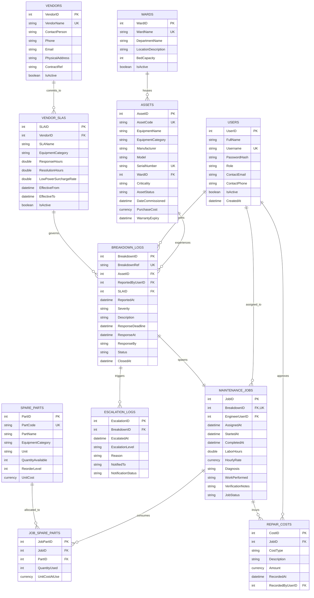

# Entity-Relationship Diagram (ERD) & Relational Mapping
## County Referral Hospital Biomedical Equipment Maintenance & SLA System (HBMS)

**Unit Code & Title:** ECE 2423 – Advanced Programming  
**Programme:** Bachelor of Technology in Electrical and Computer Engineering (Year IV, Semester I)  
**Academic Year:** 2026/2027  
**Institution:** Kirinyaga University — School of Pure and Applied Sciences  
**Lecturer:** Dr. Stephen Kahara Wanjau, PhD  
**Group:** Group 4  
**Assigned Case Study:** Group 4 — County Referral Hospital Biomedical Equipment Maintenance & SLA System  
**Document Version:** 1.0  
**Tracking Issue:** [Issue #6: [TASK-2.2] Database Normalization Analysis (1NF to 3NF) & Entity-Relationship Diagram (ERD)](https://github.com/ECE-Group4/CAT2-/issues/6)

---

## 1. Visual Entity-Relationship Diagram (Crow's Foot Notation)

The diagram below documents the complete entity-relationship model for `HBMS.accdb` with explicit Primary Keys (`PK`), Foreign Keys (`FK`), Unique Keys (`UK`), and cardinalities:

---

## 2. Cardinality & Relational Semantics

| Parent Entity | Relationship | Child Entity | Business Semantic & Rule Enforced |
|---|---|---|---|
| **`Wards`** | `1 : M` | **`Assets`** | A clinical ward accommodates zero, one, or multiple biomedical devices. An asset resides in exactly one ward at any given time. |
| **`Assets`** | `1 : M` | **`BreakdownLogs`** | An asset can experience zero or multiple breakdown events over its operational lifespan. Each breakdown refers to exactly one asset. |
| **`Vendors`** | `1 : M` | **`VendorSLAs`** | A vendor can hold multiple SLA contracts covering different equipment lines (e.g. 4-hour critical care vs 24-hour routine). Each SLA belongs to one vendor. |
| **`VendorSLAs`** | `1 : M` | **`BreakdownLogs`** | An SLA policy can govern multiple breakdown events. A breakdown log is governed by zero or one applicable vendor SLA policy. |
| **`BreakdownLogs`** | `1 : 1` | **`MaintenanceJobs`** | In this prototype design, a single breakdown event spawns exactly one active maintenance work order, enforced by a Unique Key (`UK`) on `MaintenanceJobs.BreakdownID`. |
| **`BreakdownLogs`** | `1 : M` | **`EscalationLogs`** | A breakdown incident can generate zero, one, or multiple progressive escalation audit entries if response targets continue to be breached. |
| **`MaintenanceJobs`** | `1 : M` | **`JobSpareParts`** | A maintenance job can consume multiple spare parts. Each allocation line item links to one job and one inventory part. |
| **`SpareParts`** | `1 : M` | **`JobSpareParts`** | A spare part catalog item can be allocated across multiple maintenance jobs over time. |
| **`MaintenanceJobs`** | `1 : M` | **`RepairCosts`** | A maintenance job accumulates multiple itemized cost entries (Labor, Parts, Vendor Charges). |
| **`Users`** | `1 : M` | **`BreakdownLogs`** | A clinical user can submit multiple breakdown reports. |
| **`Users`** | `1 : M` | **`MaintenanceJobs`** | A biomedical engineer can be assigned to multiple work orders. |
