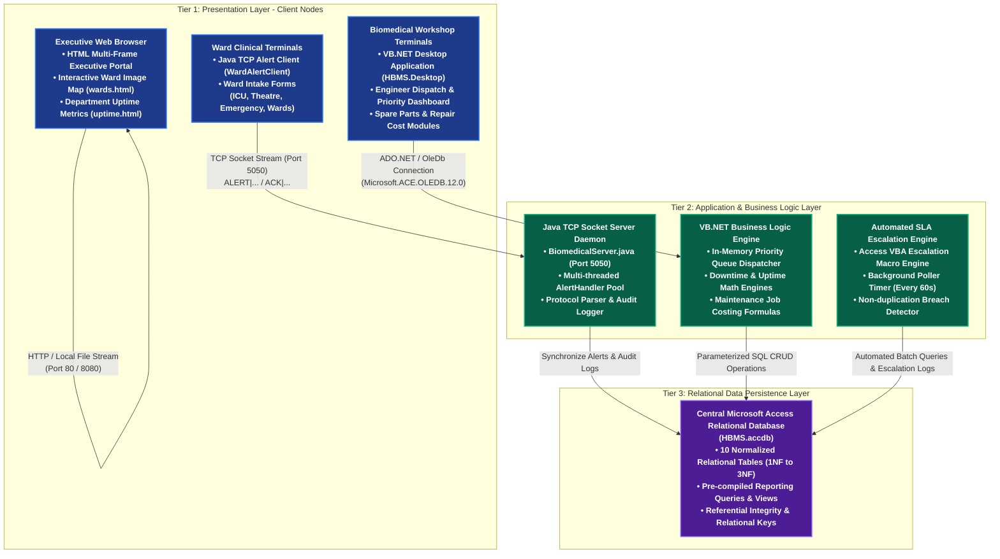

# 3-Tier Client/Server Deployment Architecture Design
## County Referral Hospital Biomedical Equipment Maintenance & SLA System (HBMS)

**Unit Code & Title:** ECE 2423 – Advanced Programming  
**Programme:** Bachelor of Technology in Electrical and Computer Engineering (Year IV, Semester I)  
**Academic Year:** 2026/2027  
**Institution:** Kirinyaga University — School of Pure and Applied Sciences  
**Lecturer:** Dr. Stephen Kahara Wanjau, PhD  
**Group:** Group 4  
**Assigned Case Study:** Group 4 — County Referral Hospital Biomedical Equipment Maintenance & SLA System  
**Document Version:** 1.0  
**Tracking Issue:** [Issue #4: [TASK-1.4] 3-Tier Client/Server Deployment Architecture Design](https://github.com/ECE-Group4/CAT2-/issues/4)

---

## 1. Architectural Overview

The **Hospital Biomedical Equipment Maintenance & SLA Management System (HBMS)** is engineered upon a classical, highly decoupled **3-Tier Client/Server Architecture**. This design separates presentation, business logic, and relational data persistence into autonomous layers to maximize maintainability, fault tolerance, data security, and operational responsiveness across hospital departments.



---

## 2. Layered Tier Specifications

### 2.1 Tier 1: Presentation Layer (User Interfaces)
The presentation layer decouples user interaction from business algorithms and database logic:
1. **Ward Terminal Client (`WardAlertClient.java`):**
   - Deployed on clinical workstations across critical hospital wards (ICU, Operating Theatre, Emergency, Radiology, General Wards).
   - Provides an intuitive interface for ward nurses and clinical officers to enter breakdown reference codes, select malfunctioning equipment, indicate clinical severity, and broadcast urgent TCP alert packets to the biomedical engineering workshop.
2. **Biomedical Engineer Desktop Dashboard (`HBMS.Desktop` - VB.NET Windows Forms):**
   - Deployed on engineering workstations in the central Biomedical Workshop.
   - Hosts the executive command center (`FrmMainDashboard`), asset management (`FrmEquipment`), breakdown triage (`FrmBreakdown`), interactive SLA monitor (`FrmSLA`), work order execution (`FrmMaintenanceJobs`), inventory control (`FrmSpareParts`), and repair expenditure accounting (`FrmRepairCosts`).
   - Utilizes custom modal dialogs (`DlgCriticalAlert`, `DlgConfirmAction`, `DlgValidationError`) to enforce human factors safety and prevent operational mistakes.
3. **Executive Management Web Portal (HTML/CSS):**
   - Accessible via any standard web browser by hospital administrators.
   - Implements traditional multi-frame layouts (`<frameset>`, `<frame>`) with client-side interactive image maps (`wards.html`) detailing departmental availability, active SLA audits, and uptime percentages.

### 2.2 Tier 2: Application / Business Logic Layer
The business logic tier processes rules, computations, and workflows independently of storage and presentation:
1. **Multi-Threaded Java TCP Workshop Server (`BiomedicalServer.java`):**
   - Listens continuously on dedicated TCP port `5050`.
   - Utilizes an `ExecutorService` thread pool to instantiate an `AlertHandler` worker thread for each connecting ward client, preventing connection bottlenecks during high incident volume.
   - Enforces packet protocol compliance (`ALERT|...`), sanitizes delimiters, writes audit trail logs, and transmits immediate structured acknowledgment responses (`ACK|...`).
2. **Clinical Priority Queue Dispatcher:**
   - In-memory data structure module (`ModDataStructures.vb`) ranking work orders by clinical urgency:
     - Priority 1: Critical Care life-support devices (Ventilators, ICU Monitors).
     - Priority 2: Emergency Department vital monitors.
     - Priority 3: General Inpatient Infusion Pumps.
     - Priority 4: Routine diagnostic and imaging equipment.
3. **Automated 4-Hour SLA Escalation Engine:**
   - Enforces the statutory response rule: for critical care assets, if $\text{ResponseAt IS NULL}$ and $\text{CurrentTime} > \text{ReportedAt} + 4\text{ Hours}$, the engine logs a formal breach into `EscalationLogs` and raises visual/audible alarms on the engineer dashboard.
4. **Financial Costing Engine:**
   - Calculates composite job expenditure:
     $$\text{Job Cost} = \text{Labor Hours} \times \text{Hourly Rate} + \sum (\text{Part Qty} \times \text{Unit Cost}) + \text{Vendor Fees}$$

### 2.3 Tier 3: Data Persistence Layer (Database)
The persistence tier provides centralized, ACID-compliant relational data management:
1. **Microsoft Access Database (`HBMS.accdb`):**
   - Hosted on a secured, high-availability local network file server in the biomedical workshop.
   - Comprises 10 normalized relational tables in Third Normal Form (3NF).
   - Enforces Primary Key (PK) and Foreign Key (FK) referential integrity with cascade protection on critical audit tables.
2. **ADO.NET / OleDb Connection Management:**
   - Uses `Microsoft.ACE.OLEDB.12.0` (or `Microsoft.Jet.OLEDB.4.0`) provider with parameterized SQL commands to completely prevent SQL injection vulnerabilities.

---

## 3. Physical Hospital Deployment & Network Topology

```mermaid
graph LR
    subgraph Clinical Wards Subnet [VLAN 10: Clinical Wards Subnet (192.168.10.0/24)]
        ICU["ICU Terminal<br/>192.168.10.11"]
        OT["Theatre Terminal<br/>192.168.10.12"]
        ED["Emergency Terminal<br/>192.168.10.13"]
        GW["General Ward Terminal<br/>192.168.10.14"]
    end

    subgraph Core Network Infrastructure [Hospital Core Network Backbone]
        SW["Core L3 Managed Switch<br/>Hospital Backbone (10 Gbps)"]
    end

    subgraph Biomedical Workshop Subnet [VLAN 20: Biomedical Workshop Subnet (192.168.20.0/24)]
        SRV["Central Biomedical Server<br/>192.168.20.5<br/>• Java Socket Daemon (Port 5050)<br/>• MS Access File Share (SMB 445)<br/>• HBMS.accdb Database"]
        ENG1["Biomedical Workstation 1<br/>192.168.20.10<br/>• HBMS.Desktop"]
        ENG2["Biomedical Workstation 2<br/>192.168.20.11<br/>• HBMS.Desktop"]
    end

    subgraph Administration Subnet [VLAN 30: Executive Administration Subnet (192.168.30.0/24)]
        ADM["CEO / Medical Director Workstation<br/>192.168.30.15<br/>• HTML Executive Portal"]
    end

    ICU --> SW
    OT --> SW
    ED --> SW
    GW --> SW

    SW -- "TCP Port 5050 (Alert Packets)" --> SRV
    SW -- "SMB / CIFS (Port 445)" --> SRV

    ENG1 --> SW
    ENG2 --> SW
    ADM --> SW
```

### 3.1 Network Port Allocation & Firewall Rules
| Protocol / Port | Source | Destination | Purpose | Security Policy |
|---|---|---|---|---|
| **TCP 5050** | Ward Terminals (VLAN 10) | Biomedical Server (192.168.20.5) | Urgent breakdown alert packets (`ALERT|...`) | Restricted to internal VLAN traffic. |
| **SMB / CIFS (TCP 445)** | Workshop Terminals (VLAN 20) | Central File Share (192.168.20.5) | Shared access to `HBMS.accdb` | Windows Authenticated Share permissions; encrypted SMB. |
| **HTTP (TCP 80 / 8080)** | Administration (VLAN 30) | Web Server / Local Portal | Executive portal viewing (`index.html`) | Read-only administrative access. |

---

## 4. Architectural Non-Functional Qualities

1. **Decoupling & Modularity:** Changes to user interface forms do not alter relational table structures, and database schema migrations do not break the network socket communication protocol.
2. **Concurrency & Locking:** MS Access employs page-level/record-level locking; ADO.NET connection pooling minimizes lock contention by keeping connections open only during active query execution.
3. **Resilience & Fault Tolerance:** If the executive web portal or desktop application is closed, the Java socket listener continues operating as an independent daemon on the server. If the network experiences temporary interruption, ward clients report descriptive timeout errors without terminating unexpectedly.
4. **Academic Compliance:** The 3-tier architecture directly satisfies the ECE 2423 CAT 2 requirement for a structured deployment model connecting wards, the workshop, and management.
