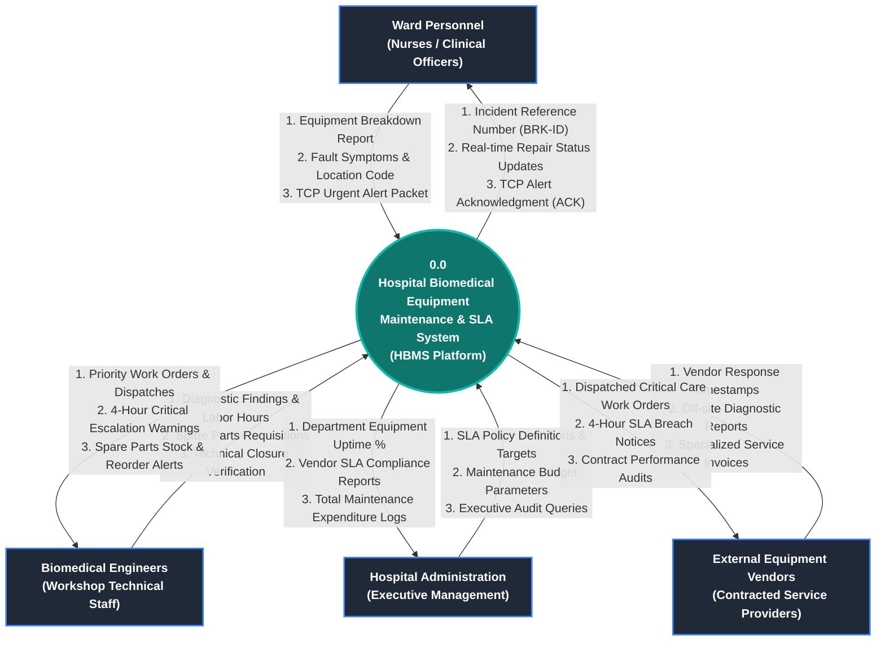

# System Context Diagram (Level-0 DFD)
## County Referral Hospital Biomedical Equipment Maintenance & SLA System (HBMS)

**Unit Code & Title:** ECE 2423 – Advanced Programming  
**Programme:** Bachelor of Technology in Electrical and Computer Engineering (Year IV, Semester I)  
**Academic Year:** 2026/2027  
**Institution:** Kirinyaga University — School of Pure and Applied Sciences  
**Lecturer:** Dr. Stephen Kahara Wanjau, PhD  
**Group:** Group 4  
**Assigned Case Study:** Group 4 — County Referral Hospital Biomedical Equipment Maintenance & SLA System  
**Document Version:** 1.0  
**Tracking Issue:** [Issue #2: [TASK-1.2] System Context Diagram (Level-0 DFD) & Information Boundary Modeling](https://github.com/ECE-Group4/CAT2-/issues/2)

---

## 1. System Boundary & Architectural Scope

The **System Context Diagram** (also designated as a Level-0 Data Flow Diagram) establishes the primary structural boundary of the **Hospital Biomedical Equipment Maintenance & SLA Management System (HBMS)**. It models the system as a single central process interacting with external human and institutional entities.

### 1.1 Scope Delineation
- **Inside the System Boundary:** All internal automated processes, business logic engines, database transactions, priority queue algorithms, automated 4-hour SLA escalation monitoring, cost calculations, and network socket listeners.
- **Outside the System Boundary (External Terminators):** Clinical ward staff, biomedical workshop engineers, hospital executive management, and third-party medical equipment vendors.

---

## 2. Visual Context Diagram (Level-0 DFD)

---

## 3. External Entity Information Exchange Dictionary

The following table provides a rigorous catalog of every incoming and outgoing data flow represented in the Context Diagram:

### 3.1 Ward Personnel (Nurses / Clinical Officers)
| Data Flow Direction | Data Flow Name | Description & Contained Attributes |
|---|---|---|
| **Input $\rightarrow$ HBMS** | Equipment Breakdown Report | Asset identifier, failure occurrence time, clinical department code, user ID. |
| **Input $\rightarrow$ HBMS** | Fault Symptoms & Location | Detailed failure narrative (e.g., pressure loss, error code, power failure), physical bed/room location. |
| **Input $\rightarrow$ HBMS** | TCP Urgent Alert Packet | Delimiter-separated TCP socket stream: `ALERT|BreakdownRef|AssetCode|WardID|Severity|Timestamp|Description`. |
| **Output $\leftarrow$ HBMS** | Incident Reference Number | Unique tracking string (e.g., `BRK-2026-089`) issued upon successful fault commitment. |
| **Output $\leftarrow$ HBMS** | Repair Status Updates | Current state indicator: `Assigned`, `In Progress`, `Awaiting Parts`, `Completed`. |
| **Output $\leftarrow$ HBMS** | TCP Alert Acknowledgment | Structured socket response: `ACK|BreakdownRef|Status|Timestamp`. |

### 3.2 Biomedical Engineers (Workshop Technical Staff)
| Data Flow Direction | Data Flow Name | Description & Contained Attributes |
|---|---|---|
| **Input $\rightarrow$ HBMS** | Diagnostic Findings & Labor | Root-cause analysis notes, technician ID, labor start/stop timestamps. |
| **Input $\rightarrow$ HBMS** | Spare Parts Requisitions | Part identification code, quantity consumed for specific job. |
| **Input $\rightarrow$ HBMS** | Technical Closure Verification | Post-repair calibration notes, electrical safety test verification, operational sign-off. |
| **Output $\leftarrow$ HBMS** | Priority Work Orders | Triaged jobs ordered by clinical criticality (Critical Care life-support pre-empting routine). |
| **Output $\leftarrow$ HBMS** | 4-Hour Escalation Warnings | Visual and audible modal alerts (`DlgCriticalAlert`) for unacknowledged critical emergencies. |
| **Output $\leftarrow$ HBMS** | Spare Parts Stock Alerts | Reorder warnings when `QuantityAvailable <= ReorderLevel`. |

### 3.3 Hospital Administration (Executive Management)
| Data Flow Direction | Data Flow Name | Description & Contained Attributes |
|---|---|---|
| **Input $\rightarrow$ HBMS** | SLA Policy Definitions | Contractual response deadlines (4 hours for critical care) and resolution targets. |
| **Input $\rightarrow$ HBMS** | Executive Audit Queries | Date filters, ward filters, and equipment category parameters for reporting. |
| **Output $\leftarrow$ HBMS** | Department Equipment Uptime % | Operational availability percentages by ward (ICU, Theatre, Radiology, Emergency, Wards). |
| **Output $\leftarrow$ HBMS** | Vendor SLA Compliance Reports | Comparison tables: contracted response hours vs actual acknowledgment hours. |
| **Output $\leftarrow$ HBMS** | Maintenance Expenditure Logs | Aggregated financial summaries: `Labor Cost + Spare Parts Cost + Vendor Invoices`. |

### 3.4 External Equipment Vendors (Contracted Manufacturers)
| Data Flow Direction | Data Flow Name | Description & Contained Attributes |
|---|---|---|
| **Input $\rightarrow$ HBMS** | Vendor Response Timestamps | Official receipt and dispatch acknowledgment timestamp (`ResponseAt`). |
| **Input $\rightarrow$ HBMS** | Off-site Diagnostic Reports | Technical field service reports for specialized OEM repairs. |
| **Input $\rightarrow$ HBMS** | Specialized Service Invoices | Itemized billing fees for external technician labor and proprietary parts. |
| **Output $\leftarrow$ HBMS** | Dispatched Work Orders | Machine specifications, ward location, failure logs, and contract SLA deadline. |
| **Output $\leftarrow$ HBMS** | 4-Hour SLA Breach Notices | Automated formal notices dispatched when vendor fails to respond within 4 hours. |

---

## 4. Boundary Verification & Architectural Integrity

The Level-0 Context Diagram guarantees strict adherence to software engineering principles:
1. **High Cohesion & Clear Boundary:** All internal transactional databases (`Assets`, `BreakdownLogs`, `EscalationLogs`) and memory structures (Priority Queues) reside strictly within the HBMS boundary.
2. **Actor Decoupling:** External actors interact solely through structured interfaces (Forms, HTML frames, TCP socket packets) rather than accessing raw database tables directly.
3. **Traceability:** Every data flow directly feeds functional processes defined in the subsequent Level-1 Data Flow Diagram (DFD Level-1).
