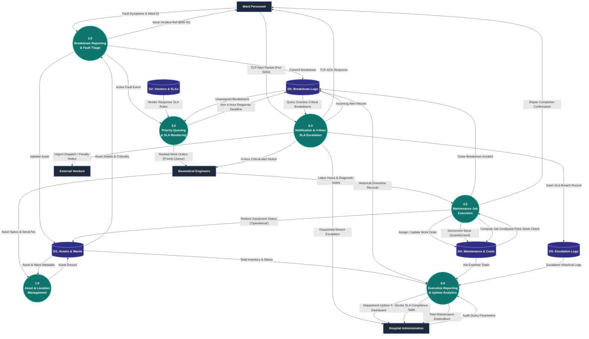

# Data Flow Diagram (DFD Level-1) & Functional Decomposition
## County Referral Hospital Biomedical Equipment Maintenance & SLA System (HBMS)

**Unit Code & Title:** ECE 2423 – Advanced Programming  
**Programme:** Bachelor of Technology in Electrical and Computer Engineering (Year IV, Semester I)  
**Academic Year:** 2026/2027  
**Institution:** Kirinyaga University — School of Pure and Applied Sciences  
**Lecturer:** Dr. Stephen Kahara Wanjau, PhD  
**Group:** Group 4  
**Assigned Case Study:** Group 4 — County Referral Hospital Biomedical Equipment Maintenance & SLA System  
**Document Version:** 1.0  
**Tracking Issue:** [Issue #3: [TASK-1.3] Data Flow Diagram (DFD Level-1) & Functional Process Decomposition](https://github.com/ECE-Group4/CAT2-/issues/3)

---

## 1. Functional Process Decomposition

The **Level-1 Data Flow Diagram (DFD Level-1)** decomposes the single Level-0 context bubble into six core functional sub-processes. It details the internal transformation of information flows between external entities, business logic algorithms, and persistent relational data stores.

### 1.1 Core Sub-Processes
1. **Process 1.0 (Asset & Ward Management):** Ingestion, cataloging, ward allocation, and lifecycle tracking of biomedical medical devices.
2. **Process 2.0 (Breakdown Reporting & Fault Triage):** Intake of equipment failure events, automated reference key generation, and fault symptom recording.
3. **Process 3.0 (Priority Queuing & SLA Tracking):** In-memory dynamic prioritization of life-critical equipment ahead of routine equipment, and response countdown tracking.
4. **Process 4.0 (Maintenance Work Order Execution):** Technician dispatch, diagnostic notes logging, spare parts stock decrementing, labor recording, and technical restoration.
5. **Process 5.0 (Notification & 4-Hour Automated Escalation):** Ingestion of Java TCP socket alert packets and automated triggering of escalation events for unacknowledged critical emergencies.
6. **Process 6.0 (Executive Reporting & Uptime Analytics):** Calculation of department-wise operational uptime percentages, aggregation of total repair expenses, and vendor SLA audit reporting.

### 1.2 Persistent Relational Data Stores
- **D1: Assets & Wards Repository** (`Assets`, `Wards`)
- **D2: Vendors & SLA Contracts** (`Vendors`, `VendorSLAs`)
- **D3: Breakdown Incident Logs** (`BreakdownLogs`)
- **D4: Maintenance Jobs & Inventory Costs** (`MaintenanceJobs`, `SpareParts`, `JobSpareParts`, `RepairCosts`)
- **D5: Audit & SLA Escalation Records** (`EscalationLogs`)

---

## 2. Visual DFD Level-1 Diagram

---

## 3. Detailed Process Specifications

### 3.1 Process 1.0: Asset & Location Management
- **Input:** Biomedical engineering specifications, manufacturer serial numbers, model details, commissioning dates, ward allocations.
- **Transformation:**
  1. Validates uniqueness of `AssetCode` and `SerialNumber`.
  2. Maps asset to foreign key `WardID` representing hospital wards.
  3. Classifies clinical criticality (`Critical Care` vs `General Care`).
- **Output:** Writes new or modified equipment records to **D1: Assets & Wards**.

### 3.2 Process 2.0: Breakdown Reporting & Fault Triage
- **Input:** Fault report submitted by ward nurse or intake desk (Asset code, failure symptoms, severity level).
- **Transformation:**
  1. Verifies asset existence and active operational state from **D1**.
  2. Generates system-wide unique reference key: `BRK-YYYY-NNN`.
  3. Records timestamp: `ReportedAt = Now()`.
  4. Changes `Assets.AssetStatus` from `Operational` to `Under Maintenance`.
- **Output:** Commits record into **D3: Breakdown Logs**; returns `BreakdownRef` to reporter; passes breakdown event to Process 3.0.

### 3.3 Process 3.0: Priority Queuing & SLA Monitoring
- **Input:** Active breakdown events from Process 2.0; contractual SLA response thresholds from **D2**.
- **Transformation:**
  1. Evaluates asset criticality: if equipment category $\in \{\text{Ventilators}, \text{ICU Patient Monitors}\}$ or `Severity = 'Critical'`, assigns Priority Score = 1 (Critical Care).
  2. Assigns Priority 2 to Emergency department vital monitors; Priority 3 to general ward infusion pumps; Priority 4 to non-urgent diagnostic systems.
  3. Calculates response window: $\text{ResponseDeadline} = \text{ReportedAt} + 4\text{ Hours}$ for critical care.
  4. Enqueues into memory priority queue sorted by `(PriorityScore ASC, ReportedAt ASC)`.
- **Output:** Dispatches prioritized work order queue to Biomedical Engineers; updates `ResponseDeadline` in **D3**.

### 3.4 Process 4.0: Maintenance Work Order Execution
- **Input:** Engineer assignment, labor start/stop timestamps, diagnostic summaries, spare parts requests.
- **Transformation:**
  1. Creates work order entry in **D4: MaintenanceJobs** (`JobStatus = 'Assigned'`).
  2. On parts requisition, verifies `SpareParts.QuantityAvailable >= QuantityUsed`. If valid, decrements inventory and inserts into `JobSpareParts`.
  3. Calculates total expenditure:
     $$\text{Job Cost} = \text{Labor Hours} \times \text{Hourly Rate} + \sum (\text{Part Qty} \times \text{Unit Cost}) + \text{Vendor Fees}$$
  4. Calculates downtime: $\text{Downtime} = \text{CompletedAt} - \text{ReportedAt}$.
  5. Updates equipment state in **D1** back to `Operational`.
- **Output:** Updates **D4** with completed job logs and cost itemization; updates **D3** (`Status = 'Closed'`); notifies ward of equipment return.

### 3.5 Process 5.0: Notification & 4-Hour Automated SLA Escalation
- **Input:** Ward TCP socket alert packets (`ALERT|...`) on port 5050; periodic system timer tick.
- **Transformation:**
  1. Socket listener parses TCP stream, validates token structure, logs alert to audit file, writes incident to **D3**, and emits immediate TCP `ACK` packet.
  2. Background escalation daemon polls **D3** for records matching:
     $$\text{Severity} = \text{'Critical'} \quad \text{AND} \quad \text{ResponseAt IS NULL} \quad \text{AND} \quad \text{Now()} > \text{ResponseDeadline}$$
  3. Checks **D5: Escalation Logs** to verify that `BreakdownID` has not already been escalated.
  4. Inserts formal breach record into **D5** (`EscalatedAt = Now()`, `Level = 'Level-1 Executive Alert'`).
  5. Updates `BreakdownLogs.Status = 'ESCALATED'`.
- **Output:** Dispatches immediate modal warning to workshop console; transmits escalation report to Hospital Administration and vendor penalty dispatch.

### 3.6 Process 6.0: Executive Reporting & Uptime Analytics
- **Input:** Administrative filter criteria; data store queries from **D1**, **D3**, **D4**, and **D5**.
- **Transformation:**
  1. Computes department-level availability:
     $$\text{Uptime (\%)} = \left[ \frac{\text{Total Available Hours} - \text{Downtime Hours}}{\text{Total Available Hours}} \right] \times 100$$
  2. Aggregates vendor compliance: compares contractual response SLA vs actual acknowledgment timestamp.
  3. Summarizes total maintenance expenditure itemized by department and asset category.
- **Output:** Populates HTML Executive Dashboard (`overview.html`, `sla.html`, `uptime.html`) and exports summary reports.

---

## 4. DFD Balancing Verification

The Level-1 Data Flow Diagram balances with the Level-0 System Context Diagram:
- All external terminators (Ward Personnel, Biomedical Engineers, Hospital Administration, External Vendors) have identical input and output data flow interfaces.
- Net information inflows and outflows preserve conservation of data across hierarchical levels.
- Persistent stores D1 through D5 provide complete relational isolation and support all reporting requirements.
