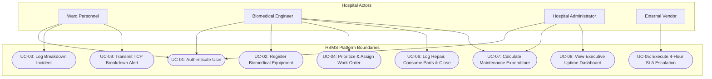

# Software Requirements Specification (SRS)
## County Referral Hospital Biomedical Equipment Maintenance & SLA System (HBMS)

**Unit Code & Title:** ECE 2423 – Advanced Programming  
**Programme:** Bachelor of Technology in Electrical and Computer Engineering (Year IV, Semester I)  
**Academic Year:** 2026/2027  
**Institution:** Kirinyaga University — School of Pure and Applied Sciences  
**Lecturer:** Dr. Stephen Kahara Wanjau, PhD  
**Group:** Group 4  
**Assigned Case Study:** Group 4 — County Referral Hospital Biomedical Equipment Maintenance & SLA System  
**Document Version:** 1.0  
**Tracking Issue:** [Issue #1: [TASK-1.1] Software Requirements Specification (SRS) & Use Case Modeling](https://github.com/ECE-Group4/CAT2-/issues/1)

---

## 1. Introduction

### 1.1 Purpose
This Software Requirements Specification (SRS) establishes the complete functional and non-functional requirements for the **Hospital Biomedical Equipment Maintenance & Service Level Agreement (SLA) Management System (HBMS)**. This document serves as the formal engineering baseline for system design, database implementation, desktop GUI construction, network communication, web portal visualization, and academic verification.

### 1.2 Problem Formulation & Context
County Referral Hospitals manage high volumes of life-critical biomedical assets across specialized clinical departments (e.g., Intensive Care Units, Operating Theatres, Emergency Departments, Radiology, and General Wards). Equipment downtime directly threatens patient survival, quality of care, and diagnostic throughput. Currently, healthcare facilities face several systemic operational bottlenecks:
1. **Unstructured Breakdown Logging:** Ward staff log equipment faults through informal phone calls or paper logbooks, causing communication delays and loss of incident accountability.
2. **Vendor SLA Breaches:** External medical equipment manufacturers and contracted maintenance service providers routinely exceed agreed response times with zero automated tracking or audit trails.
3. **Absence of Priority Triage:** Life-support systems (ventilators, ICU monitors) compete on an undifferentiated first-come, first-served basis with non-critical diagnostic units.
4. **Opaque Maintenance Costs & Inventory Leakage:** Spare parts consumption, engineering labor hours, and external contractor fees are untracked, preventing accurate equipment lifecycle cost accounting.

HBMS provides an integrated, multi-tier software prototype that bridges ward clinical staff, biomedical workshop engineers, hospital executives, and external vendors into an automated, accountable maintenance workflow.

### 1.3 Target Biomedical Equipment Categories
To satisfy the requirements of the ECE 2423 CAT 2 brief, the system explicitly models and manages four core clinical equipment categories:
1. **Ventilators:** Invasive and non-invasive mechanical life-support ventilators (e.g., Hamilton-C6, Draeger Evita V800, Puritan Bennett 980). *Criticality: Critical Care.*
2. **Patient Monitors:** Multi-parameter vital signs monitors tracking ECG, SpO2, NIBP, and invasive pressures (e.g., Mindray ePM 12M, Philips IntelliVue MX40). *Criticality: Critical Care / High.*
3. **Infusion Pumps:** Volumetric syringe and drip infusion pumps delivering continuous intravenous medication (e.g., Alaris GH Plus, B. Braun Infusomat Space). *Criticality: Medium.*
4. **X-Ray Units:** Mobile and stationary diagnostic radiography imaging systems (e.g., GE Optima XR220amx, Shimadzu MobileDaRt Evolution). *Criticality: High / Routine Diagnostic.*

---

## 2. Overall System Description

### 2.1 Product Perspective & System Context
HBMS operates as a three-tier client-server solution designed for a municipal or county referral hospital campus. It interfaces:
- **Presentation Layer:** Visual Basic .NET Desktop Client for Biomedical Workshop staff, Java CLI/GUI Alert Client for remote Ward Terminals, and an HTML/CSS Executive Portal for administrative oversight.
- **Application / Logic Layer:** In-memory clinical priority queues, automated 4-hour SLA escalation engine, cost computation formulas, and a multi-threaded Java TCP Socket Server (`BiomedicalServer`) listening on port 5050.
- **Data Persistence Layer:** Centralized Microsoft Access Relational Database (`HBMS.accdb`) maintaining normalized entity relations with referential integrity.

### 2.2 System Actors & User Roles
| Actor / User Role | Clinical / Operational Domain | System Permissions & Responsibilities |
|---|---|---|
| **Ward Personnel** (Nurses, Clinical Officers) | Clinical Wards (ICU, Theatre, Emergency, General Wards) | Submit breakdown reports, specify failure symptoms, dispatch urgent alerts via Java socket client, and track repair status. |
| **Biomedical Engineers** | Central Biomedical Engineering Workshop | Triage work orders via Priority Queue, inspect assets, record diagnostic findings, consume spare parts, log labor hours, and verify repair closure. |
| **Hospital Administrators** | Executive Administration & Quality Assurance | Audit vendor SLA compliance, analyze department-level equipment uptime/downtime percentages, and review maintenance expenditure reports. |
| **External Vendors** | Equipment Manufacturers & Contracted Technicians | Receive automated dispatch notices, acknowledge service requests, perform contractual repairs, and supply invoices. |
| **System Administrator** | IT & Biomedical Informatics | Maintain user credentials, role access levels, master ward data, and system lookup tables. |

---

## 3. Functional Requirements (FR)

The system satisfies the following functional requirements categorized by operational domain:

### 3.1 Asset & Ward Location Management
- **FR-01 (Asset Registration):** The system shall allow authorized biomedical staff to register new biomedical equipment assets, capturing `AssetCode` (unique), `EquipmentName`, `EquipmentCategory`, `Manufacturer`, `Model`, `SerialNumber` (unique), `Criticality` (Critical Care, General Care), `AssetStatus` (Operational, Malfunctioning, Under Repair, Decommissioned), and `DateCommissioned`.
- **FR-02 (Ward Mapping):** The system shall maintain hospital ward and department metadata (`WardID`, `WardName`, `DepartmentName`, `LocationDescription`, `IsActive`) and enforce referential mapping between assets and their assigned ward locations.

### 3.2 Vendor & SLA Contract Management
- **FR-03 (Vendor Master Register):** The system shall store contracted biomedical vendor profiles including `VendorID`, `VendorName`, `ContactPerson`, `Phone`, `Email`, and physical address.
- **FR-04 (SLA Configuration):** The system shall allow administrators to define Service Level Agreement terms (`VendorSLAs`) specifying maximum response time windows (`ResponseHours`) and maximum resolution targets (`ResolutionHours`) mapped to specific vendors and equipment categories.

### 3.3 Breakdown Reporting & Clinical Triage
- **FR-05 (Breakdown Intake):** The system shall allow ward staff and workshop intake officers to log equipment failure incidents, automatically generating a unique incident reference code (e.g., `BRK-2026-001`), capturing `AssetID`, `ReportedByUserID`, `ReportedAt` timestamp, `Severity` (Critical, High, Medium, Low), and symptom descriptions.
- **FR-06 (Clinical Priority Queuing):** The system shall organize incoming work orders into an in-memory priority queue structure prioritizing life-support assets (Ventilators and ICU Monitors) ahead of routine general equipment, applying Secondary FIFO ordering based on `ReportedAt`.

### 3.4 Automated 4-Hour SLA Escalation Engine
- **FR-07 (Automated 4-Hour Escalation):** For all breakdown incidents involving Critical Care equipment (Ventilators / ICU Monitors) or flagged with `Severity = 'Critical'`, the system shall automatically set:
  $$\text{ResponseDeadline} = \text{ReportedAt} + 4.0\text{ Hours}$$
  If the vendor or internal engineer does not record an official acknowledgment timestamp (`ResponseAt IS NULL`) and system time exceeds `ResponseDeadline`:
  1. The system shall insert an immutable audit record into `EscalationLogs`.
  2. The system shall flag the incident status as `ESCALATED`.
  3. The system shall dispatch an immediate alert notification to executive administration.
  4. The system shall enforce non-duplication so an overdue incident is escalated exactly once.

### 3.5 Maintenance Work Orders & Diagnostics
- **FR-08 (Work Order Lifecycle Management):** The system shall track the maintenance job lifecycle through standardized states: `Assigned` $\rightarrow$ `In Progress` $\rightarrow$ `Awaiting Parts` $\rightarrow$ `Completed` $\rightarrow$ `Verified`.
- **FR-09 (Diagnostic & Downtime Logging):** When an engineer completes a work order, the system shall record `StartedAt`, `CompletedAt`, diagnostic findings, corrective actions taken, and calculate total equipment downtime:
  $$\text{Downtime (Hours)} = \frac{\text{CompletedAt} - \text{ReportedAt}}{60\text{ minutes}}$$
  Upon verification, the system shall restore `Assets.AssetStatus = 'Operational'`.

### 3.6 Spare Parts Inventory & Financial Accounting
- **FR-10 (Spare Parts Stock Control):** The system shall maintain an inventory catalog (`SpareParts`) tracking `PartCode`, `PartName`, `QuantityAvailable`, `ReorderLevel`, and `UnitCost`. When parts are allocated to a repair job in `JobSpareParts`, the system shall automatically deduct stock quantities and prevent allocations exceeding available inventory.
- **FR-11 (Maintenance Job Costing):** The system shall automatically compute total expenditure for every completed maintenance job using the standard cost formula:
  $$\text{Total Job Cost} = \text{Labor Charges} + \sum (\text{Part Quantity Used} \times \text{Unit Cost}) + \text{External Vendor Fees}$$

### 3.7 Web Executive Portal & Network Notification Subsystem
- **FR-12 (Executive Uptime Portal):** The system shall provide an HTML/CSS executive dashboard displaying department-wise equipment availability calculated via:
  $$\text{Uptime (\%)} = \left[ \frac{\text{Observation Period (Hours)} - \text{Total Downtime (Hours)}}{\text{Observation Period (Hours)}} \right] \times 100$$
- **FR-13 (Java TCP Socket Alerting):** The system shall provide a multi-threaded Java TCP Socket Server (`BiomedicalServer`) listening on port 5050 that receives urgent breakdown packets (`ALERT|...`) from ward client terminals (`WardAlertClient`), validates packet tokens, logs alerts to audit files, and returns structured acknowledgments (`ACK|...`).

---

## 4. Non-Functional Requirements (NFR)

| Requirement ID | Quality Attribute | Engineering Specification & Metric |
|---|---|---|
| **NFR-01** | **Performance & Latency** | Desktop GUI search queries and DataGridView population shall execute in $< 500\text{ ms}$. Java TCP socket message round-trip time (transmission to ACK) shall complete in $< 100\text{ ms}$ over the local network. |
| **NFR-02** | **Role-Based Security** | The system shall enforce authentication using credentials verified against the `Users` table. System functions shall restrict access according to role: Ward User (read/log), Engineer (full work order control), Administrator (executive reports/SLA config). |
| **NFR-03** | **Data Integrity & Consistency** | Relational integrity shall be enforced through Primary Key and Foreign Key constraints in MS Access (`HBMS.accdb`). Cascade delete shall be prohibited on financial and audit entities (`BreakdownLogs`, `EscalationLogs`). |
| **NFR-04** | **Ergonomics & Usability** | Desktop user interface shall adhere to standard human factors design principles: custom modal alert dialogs for life-safety warnings, intuitive tab ordering, and color-coded SLA timers (Green: $> 2\text{h}$, Amber: $< 2\text{h}$, Red: Breached). |
| **NFR-05** | **Reliability & Fault Tolerance** | The Java socket server shall employ multi-threaded worker threads (`AlertHandler`) ensuring that abnormal client disconnects or malformed packets do not crash the listening daemon. |
| **NFR-06** | **Standards Compliance** | HTML dashboard shall implement traditional HTML 4.01 `<frameset>` and client-side `<map>` structures matching the ECE 2423 syllabus while maintaining clean CSS styling. |

---

## 5. System Use Case Modeling

### 5.1 Use Case Summary Diagram

### 5.2 Detailed Use Case Specifications

#### UC-03: Log Equipment Breakdown Incident
- **Primary Actor:** Ward Personnel / Biomedical Intake Officer.
- **Preconditions:** User is authenticated; malfunctioning asset is registered in the database.
- **Trigger:** Equipment experiences operational fault in a clinical ward.
- **Main Success Scenario:**
  1. Actor opens `FrmBreakdown` in the desktop application or initiates `WardAlertClient`.
  2. Actor selects `AssetCode` from lookup list; system populates Equipment Name, Category, Ward, and Criticality.
  3. Actor selects `Severity` (Critical, High, Medium, Low) and inputs detailed fault symptoms.
  4. System records `ReportedAt = Now()` and assigns a unique `BreakdownRef` (`BRK-YYYY-NNN`).
  5. If `Severity = Critical` or `Criticality = Critical Care`, system calculates `ResponseDeadline = ReportedAt + 4 Hours`.
  6. System saves record to `BreakdownLogs`, updates `Assets.AssetStatus = 'Under Maintenance'`, and inserts job into Priority Queue.
  7. System displays custom confirmation modal dialog containing `BreakdownRef`.
- **Postconditions:** Fault incident is registered, SLA timer is armed, and workshop alert is dispatched.

#### UC-05: Execute 4-Hour SLA Escalation Engine
- **Primary Actor:** Automated System Daemon / Background Poller.
- **Preconditions:** Active breakdown exists with `Severity = 'Critical'` or Critical Care asset category.
- **Trigger:** System clock passes `ResponseDeadline` with `ResponseAt IS NULL`.
- **Main Success Scenario:**
  1. Background poller timer executes stored query `qry_OverdueCriticalCareBreakdowns`.
  2. Query identifies unacknowledged critical breakdowns where `Now() > ResponseDeadline`.
  3. For each identified breakdown, system queries `EscalationLogs` to verify no prior escalation exists.
  4. System executes `INSERT INTO EscalationLogs` capturing `BreakdownID`, `EscalatedAt = Now()`, `EscalationLevel = 'Level-1 Executive Alert'`, and breach justification.
  5. System triggers `DlgCriticalAlert` modal dialog on workshop dashboard and sets incident status to `ESCALATED`.
  6. Escalation event is mirrored to executive dashboard audit tables.
- **Postconditions:** SLA breach is formally logged, administrative alerts are dispatched, and duplicate escalations are prevented.

#### UC-06: Log Diagnostics, Consume Spare Parts & Close Work Order
- **Primary Actor:** Biomedical Engineer.
- **Preconditions:** Work order assigned to engineer in `MaintenanceJobs`.
- **Trigger:** Engineer completes physical inspection, repair, and calibration.
- **Main Success Scenario:**
  1. Engineer opens `FrmMaintenanceJobs` and selects work order.
  2. Engineer inputs diagnostic summary and corrective actions executed.
  3. Engineer opens `FrmSpareParts` job allocation tab, selects parts consumed, and inputs quantities.
  4. System validates available stock, inserts records into `JobSpareParts`, and decrements `SpareParts.QuantityAvailable`.
  5. Engineer records `CompletedAt = Now()` and inputs verification test results.
  6. System computes equipment downtime: $\text{Downtime} = \text{CompletedAt} - \text{ReportedAt}$.
  7. System updates `Assets.AssetStatus = 'Operational'` and sets `MaintenanceJobs.JobStatus = 'Completed'`.
- **Postconditions:** Equipment is restored to clinical service, inventory is accurately decremented, and job downtime is permanently recorded.

---

## 6. Requirements Traceability Matrix

| Requirement ID | Module / Subsystem | Primary Implementation Component | Verification Test Case |
|---|---|---|---|
| **FR-01, FR-02** | Asset & Ward Registry | `FrmEquipment.vb`, `Assets` & `Wards` Tables | T-01 (Asset Registration) |
| **FR-03, FR-04** | Vendor & SLA Management | `FrmSLA.vb`, `Vendors` & `VendorSLAs` Tables | T-02 (SLA Rule Configuration) |
| **FR-05, FR-06** | Breakdown Intake & Priority | `FrmBreakdown.vb`, `ModDataStructures.vb` (Queue) | T-02 (Critical Priority Triage) |
| **FR-07** | Automated 4-Hour Escalation | `mcr_CheckEscalations` (VBA), `FrmSLA.vb` Timer | T-03 (4-Hour Breach Trigger) |
| **FR-08, FR-09** | Maintenance Work Orders | `FrmMaintenanceJobs.vb`, `MaintenanceJobs` Table | T-01, T-06 (Job Lifecycle) |
| **FR-10** | Spare Parts Stock Control | `FrmSpareParts.vb`, `JobSpareParts` Table | T-06 (Stock Allocation Check) |
| **FR-11** | Repair Cost Accounting | `FrmRepairCosts.vb`, Cost Computation Formula | T-06 (Financial Aggregation) |
| **FR-12** | Executive HTML Portal | `index.html`, `uptime.html`, `wards.html` | T-05 (Image Map & Uptime) |
| **FR-13** | Java TCP Sockets | `BiomedicalServer.java`, `WardAlertClient.java` | T-04 (TCP Packet & ACK) |
